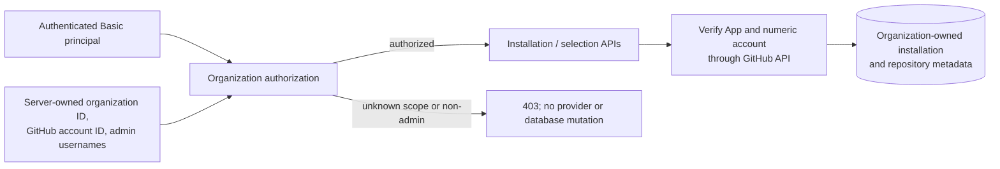
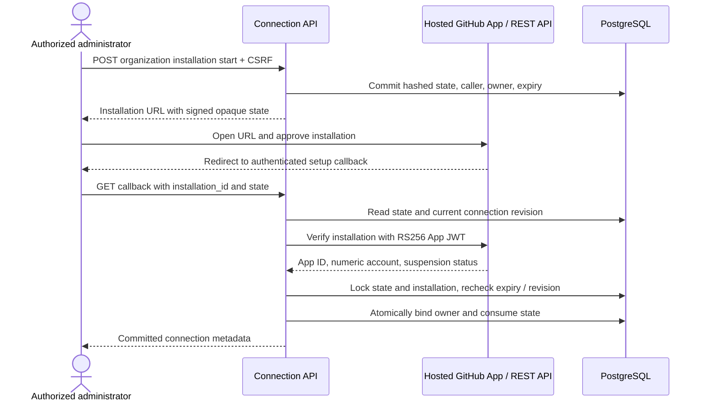
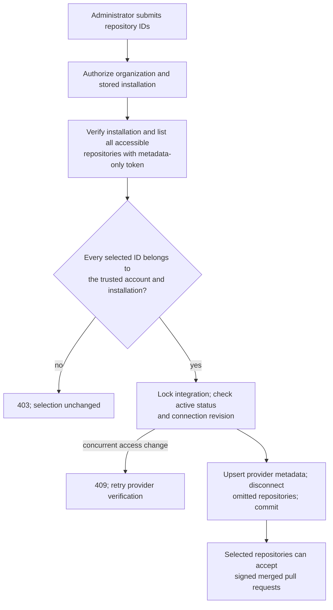
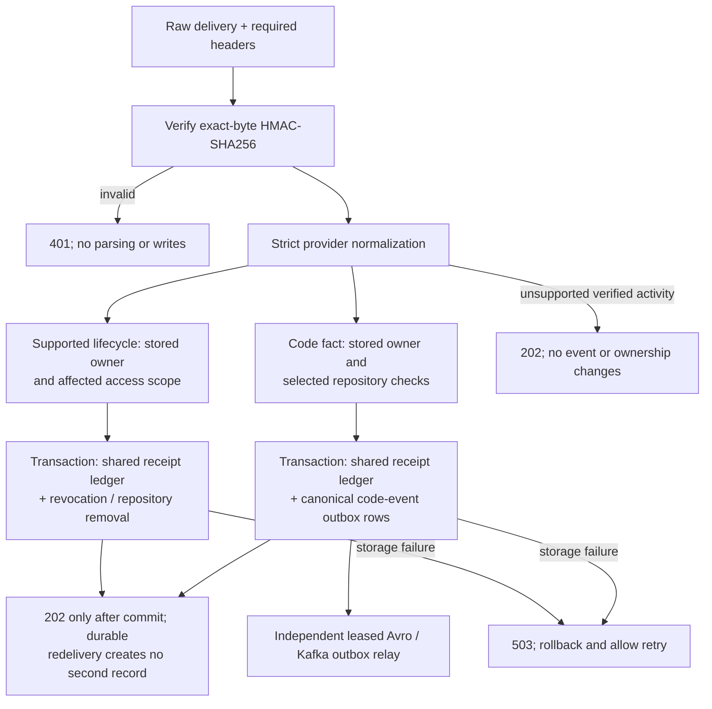

# Connector Service: GitHub connection and processing

**Status: implemented backend APIs.** A trusted organization administrator can
start a GitHub App installation, complete its callback, discover repositories,
replace the selected repository set, and disconnect a repository or installation.
Signed merged pull requests enter the PostgreSQL receipt/outbox flow. Optional
opened-PR and branch-push adapters use the same trusted ownership and outbox boundary.
Signed installation revocation, suspension, and repository-removal deliveries
update access in the same transaction as their receipt. Browser connection screens
and OIDC/JWT remain planned.

## Organization authorization subsystem

HTTP Basic authenticates the caller. Deployment configuration binds each internal
organization to one immutable GitHub account ID and an explicit set of authenticated
administrator usernames. Request bodies, organization headers, GitHub login names,
and callback query parameters cannot establish ownership. The service validates
configuration when connection management is enabled and rejects duplicate internal
organization or GitHub account bindings.



The default Basic user can be configured with Spring's `spring.security.user`
properties; the opt-in Compose file supplies them from private environment
configuration. Deployments with multiple authenticated users can supply their own
`UserDetailsService`. The organization binding list is independent of that user
store. For example, deployment YAML can override the list with:

```yaml
changeguard:
  github:
    connection:
      organizations:
        - organization-id: organization-a
          github-account-id: 123456
          administrators: [alice]
        - organization-id: organization-b
          github-account-id: 789012
          administrators: [bob, carol]
```

## Installation and callback subsystem

Start creates 256 bits of random opaque state and signs it with a separate
HMAC-SHA256 secret. PostgreSQL stores only its SHA-256 hash, authorized organization,
administrator, numeric GitHub account, expiration, and consumption time. State
expires after ten minutes by default; configuration allows one to thirty minutes.

Callback completion verifies the signature, stored identity, expiration, current
administrator authorization, App ID, GitHub account ID, and suspension status. It
looks up the installation using an App-authenticated request. It then locks and
consumes state in the same transaction that creates or restores the integration.
Replay, expired state, and a different administrator are rejected. A provider outage
or database failure leaves state usable for a retry until it expires. An already
owned installation cannot be reassigned to another organization. Repeated setup
preserves the integration ID and an active connection's existing selection.



App JWTs are signed with the mounted RSA PEM key using `RS256`, with a clock-drift
allowance and a lifetime below GitHub's ten-minute maximum. Both PKCS#1 and PKCS#8
keys are supported; keys below 2048 bits are rejected. Repository discovery mints
a short-lived installation token restricted to metadata read access. Tokens, keys,
raw state, signatures, and raw webhook bodies are not persisted. The API client
uses fixed GitHub API paths, five-second timeouts, no redirects, strict numeric
identities, and fixed pagination; response-provided URLs are never followed.
See GitHub's [App JWT documentation](https://docs.github.com/en/apps/creating-github-apps/authenticating-with-a-github-app/generating-a-json-web-token-jwt-for-a-github-app)
and [installation API](https://docs.github.com/en/rest/apps/apps#get-an-installation-for-the-authenticated-app).

## Repository selection subsystem

Discovery lists repositories available to the verified installation and trusted
GitHub account. Selection accepts only positive repository IDs, fetches current
provider metadata, and atomically replaces the selected set. An empty set disconnects
all repositories. Disconnected records remain available as historical metadata;
renames preserve numeric identity. Existing receipts and pending outbox events are
retained when a repository or integration is disconnected.



The connection revision changes on selection, callback completion, disconnection,
and supported lifecycle changes. Comparing it after provider verification prevents
a stale repository list or callback response from undoing a concurrent revocation.
Restoring a disconnected connection requires explicit repository selection again.

## Webhook processing and lifecycle subsystem

`POST /api/v1/integrations/github/webhook` preserves exact request bytes and verifies
`X-Hub-Signature-256` before parsing or database lookup. Supported code activity is
`pull_request` with `action=closed` and `merged=true`. Setting
`GITHUB_CODE_LIFECYCLE_ENABLED=true` additionally accepts `pull_request/opened` and
non-deleted `refs/heads/*` pushes. Deploy the matching change-service consumer and
V4 migrations before enabling that flag. Strict normalization requires
installation and repository-owner IDs. Internal organization ownership comes from
the stored installation; the intake transaction checks its active status, selected
repository, and verified numeric GitHub account before writing receipt and outbox.

Supported lifecycle activity is `installation/deleted`, `installation/suspend`, and
`installation_repositories/removed`. Deletion marks the stored integration revoked;
suspension marks it disconnected. Removed repositories are disconnected only within
the stored integration and organization. Creation, unsuspension, and added-repository
events do not create ownership or select repositories automatically.



Code and lifecycle deliveries share the organization/integration/delivery receipt
uniqueness key. Lifecycle receipts have no individual repository and create no code
outbox event. V4 adds this shape and an integration ownership FK without changing
the released V1–V3 migrations. Unknown or inactive merged-delivery ownership returns
`403`; malformed supported payloads return `400`; durable write/commit failures return
`503`. The independent relay continues publishing previously accepted events after
connection disconnection. An opening uses `pull_request.created_at` and its head
SHA. A push creates one `CommitCreated` outbox event per included SHA using the
commit timestamp; the pusher is recorded as an UNKNOWN actor, not assumed to be
the commit author. Event IDs include delivery and SHA, so commit ordering and
receipt-time changes do not alter identities. One receipt protects the entire
push batch; a failed write rolls back every event. Duplicate SHAs with conflicting
facts are rejected. Deleted branches, tag pushes and empty commit arrays create no
commit facts. The adapter does not backfill omitted provider history.

Keep `GITHUB_CODE_LIFECYCLE_ENABLED=false` until the consumer rollout is complete.
Subscribe the GitHub App to **Push** as well as **Pull request**, and grant Contents
read permission for push deliveries. The adapters process up to 2048 commits present
in a push payload; they do not fetch additional commits from GitHub.

## API and runtime configuration

All connection endpoints require authenticated administrator access to the scoped
organization. Authenticated writes also require CSRF. Fetch the token with
`GET /api/v1/integrations/github/csrf`, retain its `XSRF-TOKEN` cookie, and send the
returned token under the returned header name. The cookie is HttpOnly; this flow
does not create an HTTP session. The setup callback uses signed, caller-bound state.

| Method / path | Behavior |
| --- | --- |
| `POST /api/v1/organizations/{organization}/integrations/github/installations` | Commit state; return installation URL and expiry. |
| `GET /api/v1/integrations/github/callback?installation_id=...&state=...` | Verify and commit installation ownership; return metadata. |
| `GET /api/v1/organizations/{organization}/integrations/github` | List organization-owned integration status. |
| `GET .../{integration}/available-repositories` | Discover currently accessible provider repositories. |
| `GET .../{integration}/repositories` | List selected/historical repository metadata and status. |
| `PUT .../{integration}/repositories` | Replace selection with `{"repositoryIds":[12345]}`; return `204`. |
| `DELETE .../{integration}/repositories/{repository}` | Disconnect one repository; return `204`. |
| `DELETE .../{integration}` | Disconnect installation and selected repositories; return `204`. |

The standard stack leaves connection management disabled and still accepts signed
fixtures against provisioned test bindings. To configure an actual hosted App:

1. Register the App with repository **Metadata**, **Contents**, and **Pull requests**
   read permissions; subscribe to **Pull request** events. GitHub sends installation
   lifecycle events automatically. Set the webhook URL to the connector webhook
   route and the Setup URL to its callback route through your HTTPS endpoint.
2. Fill the optional App, trusted organization/account, administrator, Basic password,
   callback-state secret, and webhook secret values in private environment
   configuration. Set `GITHUB_APP_PRIVATE_KEY_FILE` to an external RSA PEM file.
   The connector's runtime UID 10001 must be able to read the mounted key.
3. Start with `docker compose -f docker-compose.yaml -f docker-compose.github.yaml up --build -d`.
   The [opt-in override](../../../docker-compose.github.yaml) mounts the key read-only
   at `/run/secrets/github_app_key`; the base stack does not mount or require it.
4. Authenticate, fetch CSRF, start installation for the configured internal
   organization, follow the returned URL, complete the callback, and select repository IDs.

For a directly launched JVM, set `GITHUB_CONNECTION_ENABLED=true`, use
`GITHUB_APP_PRIVATE_KEY_PATH` for the local PEM path, configure Spring's Basic user,
and provide the same App and ownership settings. See [.env.example](../../../.env.example)
and the [backend runtime documentation](../../README.md).

Automated tests use generated ephemeral RSA keys, a mocked GitHub REST server, and
real PostgreSQL; the wire suite also uses real Kafka and Schema Registry. They cover
authorization, single-use and concurrent callbacks, provider ownership and pagination,
repository selection, CSRF cookies, concurrent lifecycle changes, atomic rollback,
delivery deduplication, and V1–V3 migration upgrades. A real GitHub App sandbox is
deployment validation after supplying credentials; it is not required by CI.

GitHub documents push permission requirements and the payload's commit limit in
[Webhook events and payloads](https://docs.github.com/en/webhooks/webhook-events-and-payloads#push).
