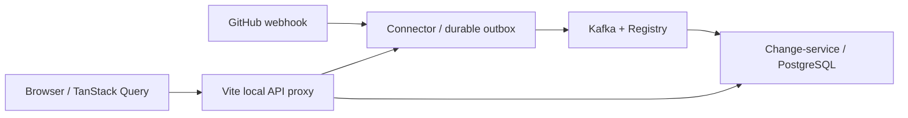

# ChangeGuard frontend

React, TypeScript, Material UI and TanStack Query power the local visual-test UI.
Changes, details, persisted timelines, GitHub installation completion and repository
selection call the real backend APIs. Services and Activity remain placeholders;
no sample activity is shipped in the application.

For a complete GitHub test, follow [Live visual testing](../docs/visual-testing.md).

## Start locally

From the repository root, start the backend infrastructure/services through Compose:

```sh
docker compose up --build -d postgres kafka schema-registry connector-service change-service
cd frontend
npm ci
cp .env.example .env.local
npm run dev
```

Open <http://localhost:5173/connections>. Apply the organization ID and API account(s)
configured on the backend. The normal Compose change reader is `changeguard` with
password `change-me` for organization `local`; these are development defaults.
The optional GitHub App override provides the separately configured connector
administrator. You can enter just the change account when checking existing records.

To run the frontend in Docker instead:

```sh
docker compose up --build -d frontend
```

Compose supplies service targets using Docker DNS. Host-run Vite defaults to
`localhost:8082` for changes and `localhost:8081` for the connector. Override the
server-only `CHANGE_API_PROXY_TARGET` and `CONNECTOR_API_PROXY_TARGET` variables if
those host ports differ. Both development and `npm run preview` use the same proxy.
Production static hosting still requires a gateway or reverse proxy for these routes.

## Routes and data

| Route | Behavior |
| --- | --- |
| `/` | Overview and navigation into live views. |
| `/changes` | Scoped list, repository-ID filter, 20-row pagination and optional five-second refresh. |
| `/changes/:id` | Current projection and its persisted timeline; five-second refresh. |
| `/connections` | Tab-scoped API accounts, projection health, GitHub installation and repository selection. |
| `/connections/github/callback` | Explicit completion of single-use installation state after returning from GitHub. |

Empty, loading, authorization and network failures are distinct. Failed background
reads preserve the last successful data and display the failure. Polling stops for
authentication/authorization errors. A commit stays separate from a pull request;
the browser does not infer missing domain relationships or provider timestamps.



## Authentication and request boundaries

`WorkspaceSessionProvider` keeps credentials only in memory. Navigating between
pages preserves them; reloading or leaving for GitHub clears them. Apply the same
connector account after returning from installation, then click **Complete
connection**. Callback completion is an explicit mutation without automatic retry,
so React StrictMode cannot consume state twice.

Changing accounts/organization or forgetting accounts cancels requests and clears
the query cache. Passwords are excluded from URLs, storage and query keys. Browser
password-manager behavior remains under the user's control. Public `VITE_*`
configuration contains only API base path and the default organization; GitHub App
keys and deployment secrets remain on the connector.

All requests use the same-origin `/api` boundary. The Vite proxy owns only these
routes and preserves caller Basic authentication, cookies and CSRF headers:

| Browser prefix | Destination |
| --- | --- |
| `/api/v1/changes` | change-service, same path |
| `/api/v1/organizations/` | connector-service, same path |
| `/api/v1/integrations/github/` | connector-service, same path |
| `/api/projection-health` | change-service `/actuator/health/projection` |

GitHub setup writes first fetch the server's CSRF details and send the returned
masked token with the HttpOnly cookie. Writes are not automatically retried.
Repository selection replaces the complete selected set. Inaccessible active
repositories stay visible until explicitly deselected; a failed read is never
interpreted as an empty selection.

Connector JSON long identifiers are converted to decimal strings using the JSON
reviver's original source, with a safe-integer fallback for older browsers. Unsafe
values fail closed when source preservation is unavailable. Selection requests
write validated positive Java-long decimal literals without `Number` conversion.

The production Gateway/BFF, OAuth/OIDC and production static hosting remain planned.
The Vite proxy is a local development bridge, not a production authentication layer.

## Verify

```sh
npm run lint
npm run typecheck
npm test
npm run build
```

Tests cover account/cache isolation, list/detail/timeline reads, pagination,
repository filtering, authorization errors, callback single use, CSRF, exact long
IDs and selection safety. A Node-environment test starts isolated loopback HTTP
servers and the real Vite proxy to verify route ownership and cookie/header/body
forwarding. Test fixtures are confined to test files.

Existing CI runs these checks plus dependency, source, container and secret scans.
See the [workflow guide](../.github/workflows/README.md). No production gateway or
real GitHub credentials are needed for the automated frontend suite.

Vite is pinned to 8.3.5 with its matching lockfile to address the advisories affecting
8.3.2. Keep development dependencies in audit and image scans: this local visual-test
container runs Vite directly. CI logs summarize audit and Trivy findings while keeping
their complete JSON reports as artifacts and retaining the HIGH/CRITICAL failure gate.
