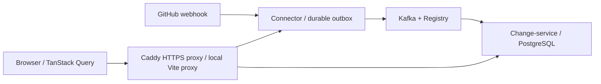

# ChangeGuard frontend

React, TypeScript, Material UI and TanStack Query power the visual-test UI.
Changes, details, persisted timelines, GitHub installation completion and repository
selection call the real backend APIs. Services and Activity remain placeholders;
no sample activity is shipped in the application.

For a complete GitHub test, follow [Live visual testing](../docs/visual-testing.md).
For the single-instance HTTPS deployment, follow [AWS visual testing](../deploy/README.md).

## Start locally

From the repository root, start the backend infrastructure/services through Compose:

```sh
docker compose up --build -d postgres kafka schema-registry connector-service change-service
cd frontend
npm ci
cp .env.example .env.local
npm run dev
```

Open <http://localhost:5173/connections>. Apply the organization ID and API account(s)
configured on the backend. The normal Compose change reader is `changeguard` with
password `change-me` for organization `local`; these are development defaults.
The optional GitHub App override provides the separately configured connector
administrator. You can enter just the change account when checking existing records.

To run the frontend in Docker instead:

```sh
docker compose up --build -d frontend
```

Compose supplies service targets using Docker DNS. Host-run Vite defaults to
`localhost:8082` for changes and `localhost:8081` for the connector. Override the
server-only `CHANGE_API_PROXY_TARGET` and `CONNECTOR_API_PROXY_TARGET` variables if
those host ports differ. Both development and `npm run preview` use the same proxy.
The default Docker image serves the compiled SPA through Caddy with the same API
routes. Local Compose explicitly selects the `development` target for hot reload.

## Hosted runtime

`docker build -t changuard-frontend:visual frontend` from the repository root builds
the static runtime. Node, npm, source files, tests and development dependencies stay
in build stages. Caddy runs as UID 10001 on unprivileged internal ports 8080/8443.
The [standalone EC2 stack](../deploy/compose.yaml) maps those to 80/443, persists
certificates and supplies the public hostname for automatic HTTPS. No source or
`node_modules` volume is mounted in the deployed frontend.

The only frontend build argument is the public `VITE_ORGANIZATION_ID`. Requests use
same-origin `/api`; service accounts are still entered in the browser. API routes
preserve authorization, CSRF and exact signed webhook bytes. Unknown `/api` routes
return 404, hashed assets are cacheable, and SPA documents/deep links refresh normally.
Request access logging is deliberately disabled to avoid recording callback queries.

Caddy 2.11.7 is compiled with Go 1.26.10 and `golang.org/x/net` 0.60.0 because the
upstream image still embeds vulnerable versions. The final Alpine image needs only
the resulting binary, CA certificates and compiled assets; it has no privileged-port
file capabilities, language toolchains or dependency trees.

## Routes and data

| Route | Behavior |
| --- | --- |
| `/` | Overview and navigation into live views. |
| `/changes` | Explicit Organization or Single repository scope, 20-row pagination and optional five-second refresh. |
| `/changes/:id` | Current projection and timeline within the applied scope; five-second refresh. |
| `/connections` | Tab-scoped API accounts, projection health, GitHub installation and repository selection. |
| `/connections/github/callback` | Explicit completion of single-use installation state after returning from GitHub. |

Empty, loading, authorization and network failures are distinct. Failed background
reads preserve the last successful data for transient failures; revoked access and
scope mismatches hide cached records. Polling stops for
authentication/authorization errors. A commit stays separate from a pull request;
the browser does not infer missing domain relationships or provider timestamps.



## Authentication and request boundaries

On **Changes**, choose and apply exactly one tracking scope before any change read:

- **Organization** shows all recorded history in the configured internal ChangeGuard
  workspace, including disconnected repositories. It is available with the change
  reader account alone. This workspace ID is separate from the GitHub owner name.
- **Single repository** requires a connector account to verify the saved active
  selection. Choose the full `owner/repository` name and immutable ID. It remains
  the active view across list/detail navigation, and every list request carries its
  exact ID. An unavailable/revoked selection pauses the view without broadening it.

Draft controls do not change the applied view until **Apply tracking scope** is
clicked. Scope changes reset pagination; account/organization changes and reloads
require choosing a scope again. Detail and timeline responses must match that scope.
Saved repository choices refresh every 15 seconds, on focus, and after intake saves.

**Connections** controls event intake separately: select one checkbox for one
repository, or **Select all available repositories** for the current installation's
accessible repositories. Save explicitly. Selecting all preserves unavailable saved
selections for explicit resolution and does not automatically include repositories
created later. Clearing and saving stops intake while retaining recorded history.

`WorkspaceSessionProvider` keeps credentials only in memory. Navigating between
pages preserves them; reloading or leaving for GitHub clears them. Apply the same
connector account after returning from installation, then click **Complete
connection**. Callback completion is an explicit mutation without automatic retry,
so React StrictMode cannot consume state twice.

Changing accounts/organization or forgetting accounts cancels requests and clears
the query cache. Passwords are excluded from URLs, storage and query keys. Browser
password-manager behavior remains under the user's control. Public `VITE_*`
configuration contains only API base path and the default organization; GitHub App
keys and deployment secrets remain on the connector.

All requests use the same-origin `/api` boundary. Caddy and the local Vite proxy own
these routes and preserve caller Basic authentication, cookies and CSRF headers:

| Browser prefix | Destination |
| --- | --- |
| `/api/v1/changes` | change-service, same path |
| `/api/v1/organizations/` | connector-service, same path |
| `/api/v1/integrations/github/` | connector-service, same path |
| `/api/projection-health` | change-service `/actuator/health/projection` |

GitHub setup writes first fetch the server's CSRF details and send the returned
masked token with the HttpOnly cookie. Writes are not automatically retried.
Repository selection replaces the complete selected set. Inaccessible active
repositories stay visible until explicitly deselected; a failed read is never
interpreted as an empty selection.

Connector JSON long identifiers are converted to decimal strings using the JSON
reviver's original source, with a safe-integer fallback for older browsers. Unsafe
values fail closed when source preservation is unavailable. Selection requests
write validated positive Java-long decimal literals without `Number` conversion.

An aggregating Gateway/BFF and OAuth/OIDC remain planned. The EC2 visual-test stack
uses the current scoped service accounts over HTTPS and does not introduce another
identity system.

## Verify

```sh
npm run lint
npm run typecheck
npm test
npm run build
```

Tests cover account/cache isolation, list/detail/timeline reads, pagination,
repository filtering, authorization errors, callback single use, CSRF, exact long
IDs and selection safety. A Node-environment test starts isolated loopback HTTP
servers and the real Vite proxy to verify route ownership and cookie/header/body
forwarding. Test fixtures are confined to test files.

`scripts/container-smoke.mjs` additionally exercises both Docker targets, static SPA
deep links, API errors, auth/CSRF forwarding, exact IDs, webhook bytes, verified local
TLS, HTTP redirects and cache headers. It uses isolated temporary containers and a
test CA; no live GitHub account, public certificate issuance or AWS account is needed.

Existing CI runs these checks plus dependency, source, container and secret scans.
See the [workflow guide](../.github/workflows/README.md). No production gateway or
real GitHub credentials are needed for the automated frontend suite.

Vite is pinned to 8.3.5 with its matching lockfile to address the advisories affecting
8.3.2. Source dependency audits include development dependencies; runtime scans cover
Caddy and the static image. CI logs summarize audit and Trivy findings while keeping
their complete JSON reports as artifacts and retaining the HIGH/CRITICAL failure gate.

The lockfile also pins jsdom's compatible transitive Undici dependency to 8.12.3,
which addresses the EventSource, integrity-check and content-encoding advisories in
8.11.2. No production dependency or audit exception is added for this test dependency.
